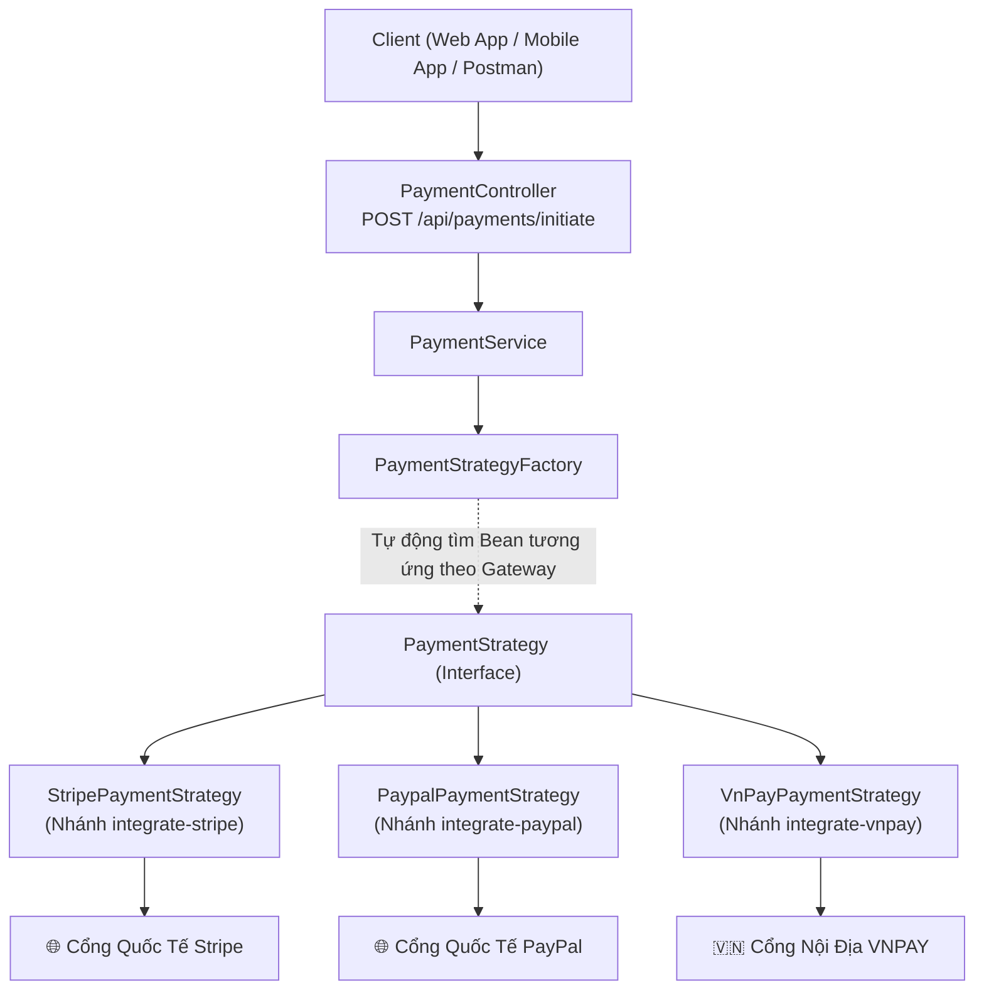

# 🛒 E-Commerce Multi-Payment Gateway Architecture (Spring Boot 4)

Dự án mẫu hướng dẫn thiết kế và xây dựng hệ thống **Đa cổng thanh toán trực tuyến (Multiple Payment Providers)** trên nền tảng **Spring Boot 4**, áp dụng các mẫu thiết kế chuẩn doanh nghiệp (**Strategy Pattern**, **Factory Pattern**), phân tách rõ rệt giữa hai pha: **Tạo đơn hàng (Order Creation)** và **Khởi tạo thanh toán (Payment Initiation)**.

Nhánh **`master`** là **nhánh khởi đầu (Starter Base Project)**: cung cấp đầy đủ khung nghiệp vụ cốt lõi (Cơ sở dữ liệu MySQL, Quản lý Sản phẩm, Tạo Đơn hàng, DTOs & Validation), sẵn sàng để bạn tích hợp bất kỳ cổng thanh toán nào.

---

## 📂 Quản lý các nhánh tích hợp (Git Branches Roadmap)

Toàn bộ mã nguồn được tổ chức thành các nhánh độc lập, giúp bạn dễ dàng theo dõi từ bước chuẩn bị cho đến khi hoàn thiện từng cổng thanh toán:

| Nhánh (Branch) | Cổng thanh toán | Công nghệ & Chuẩn tích hợp | Trạng thái |
| :--- | :--- | :--- | :--- |
| 🌟 **`master`** | **Khung dự án nền tảng** | Spring Boot 4, MySQL, Order & Product Core, Kiến trúc chuẩn bị | **Nhánh hiện tại** |
| 🇻🇳 **`integrate-vnpay`** | **Cổng VNPAY Sandbox** | Chuẩn VNPAY 2.1.0, Mã băm HMAC-SHA512, Return URL callback | Tích hợp hoàn tất |
| 🅿️ **`integrate-paypal`** | **Cổng quốc tế PayPal** | PayPal Server SDK v2.4.0, Orders API v2, Buyer Approval Redirect | Tích hợp hoàn tất |
| 💳 **`integrate-stripe`** | **Cổng quốc tế Stripe** | Stripe Java SDK v33.1, Checkout Sessions, Idempotency, Webhooks | Tích hợp hoàn tất |

---

## 🏗️ Kiến trúc Thiết kế Đa Cổng Thanh Toán (Multiple Payment Gateways)

Thay vì viết mã lồng nhiều câu lệnh `if-else` trong tầng Service khiến hệ thống trở nên cồng kềnh và khó bảo trì, kiến trúc dự án áp dụng bộ đôi **Strategy Pattern + Factory Pattern** kết hợp với **Spring IoC Container**:



### 📌 Điểm nổi bật của kiến trúc:
1. **Tuân thủ nguyên tắc Open/Closed Principle (SOLID):**
   * Muốn bổ sung thêm cổng thanh toán mới (ví dụ: MoMo, ZaloPay, VietQR), bạn chỉ việc thêm một class Strategy mới kế thừa `PaymentStrategy` kèm `@Component`.
   * Hoàn toàn **không cần sửa đổi** code hiện tại của Factory hay Service.
2. **Phân tách 2 pha: Tạo đơn trước (Order) ➜ Khởi tạo thanh toán sau (Payment):**
   * Cho phép khách hàng linh hoạt đổi phương thức thanh toán hoặc thử lại khi giao dịch bị từ chối/hủy phiên mà không làm rác hoặc hủy đơn hàng ban đầu.
3. **Tách biệt ranh giới nghiệp vụ (Decoupled Architecture):**
   * Tầng Strategy thanh toán chỉ nhận DTO chuẩn hóa `PaymentGatewayCommand`, hoàn toàn độc lập với các JPA Entities (`Order`, `Product`).

---

## 💻 Thiết lập & Khởi chạy nhanh (Quick Start)

### 1. Yêu cầu hệ thống
* **Java Development Kit (JDK):** JDK 25 trở lên.
* **Docker & Docker Compose:** Dùng để chạy MySQL 8.

### 2. Khởi chạy Cơ sở dữ liệu (MySQL)
Dự án đã có sẵn tệp `docker-compose.yaml`. Chạy lệnh sau tại thư mục gốc:
```bash
docker-compose up -d
```

### 3. Cấu hình ứng dụng
Mở tệp [application.yaml](./src/main/resources/application.yaml) để kiểm tra thông số kết nối cơ sở dữ liệu:
```yaml
spring:
  datasource:
    url: jdbc:mysql://localhost:3306/javabuilder_payments
    username: root
    password: 123456
  jpa:
    hibernate:
      ddl-auto: update
```

### 4. Khởi chạy ứng dụng
Biên dịch và khởi chạy dự án:
```bash
mvn clean spring-boot:run
```

---

## 🧪 Hướng dẫn Kiểm thử các API sẵn có trên nhánh `master`

Mở tệp tin **[api-requests.http](./api-requests.http)** và chạy lần lượt các bước kiểm thử để chuẩn bị dữ liệu:

### Bước 1: Khởi tạo danh sách sản phẩm mẫu
Chạy các request tạo sản phẩm:
* `POST http://localhost:8080/api/products` (MacBook Pro 16", Bàn phím Keychron, Màn hình Dell UltraSharp,...)
* Kiểm tra danh sách sản phẩm: `GET http://localhost:8080/api/products?page=1&size=10`

### Bước 2: Tạo đơn hàng thử nghiệm (Order Creation)
Gửi request `POST http://localhost:8080/api/orders`:
```json
{
  "items": [
    {
      "productId": 1,
      "quantity": 1
    },
    {
      "productId": 2,
      "quantity": 2
    }
  ],
  "currency": "VND"
}
```
* Phản hồi trả về mã đơn hàng `"orderCode"` (Ví dụ: `ORD-A1B2C3D4`) ở trạng thái `PENDING`.

---

## 🚀 Bước tiếp theo: Tích hợp Cổng thanh toán

Để xem toàn bộ mã nguồn cài đặt chi tiết và hướng dẫn kiểm thử thực tế cho từng cổng thanh toán, hãy chuyển sang các nhánh tương ứng:

```bash
# 1. Tích hợp cổng thanh toán nội địa VNPAY Sandbox:
git checkout integrate-vnpay

# 2. Tích hợp cổng thanh toán quốc tế PayPal (PayPal Server SDK v2):
git checkout integrate-paypal

# 3. Tích hợp cổng thanh toán quốc tế Stripe Checkout:
git checkout integrate-stripe
```

Mỗi nhánh đều có tệp tài liệu hướng dẫn chuyên sâu kèm theo:
* 🇻🇳 **VNPAY:** Hướng dẫn cấu hình `tmnCode`, `hashSecret`, thuật toán băm `HMAC-SHA512` và xử lý callback `vnp_ResponseCode`.
* 🅿️ **PayPal:** Hướng dẫn cấu hình `PaypalServerSdkClient`, Orders API v2, kiểm tra đối khớp số tiền `itemTotal` và xử lý Sandbox Buyer Account.
* 💳 **Stripe:** Hướng dẫn cấu hình `StripeClient`, quy chuẩn Zero-Decimal Currency, Idempotency Key và Stripe Webhook.
